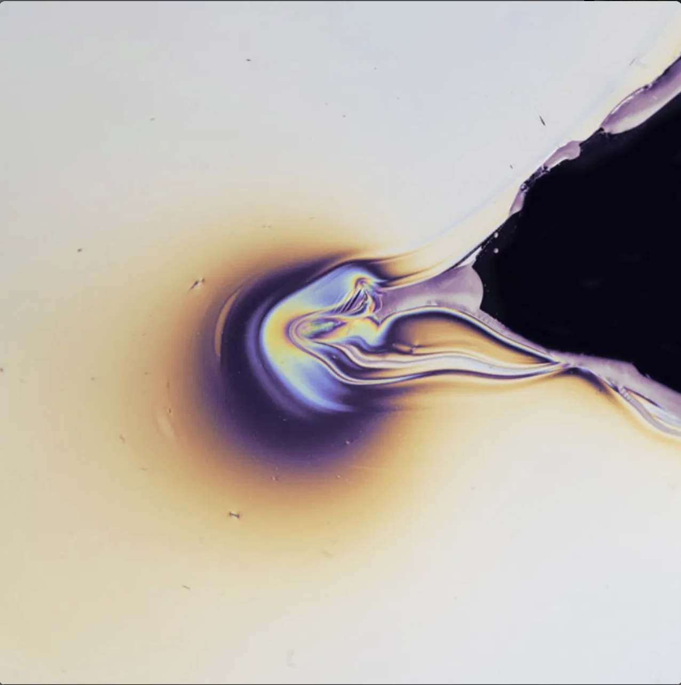

# Thin Film

浏览器里的全屏实时薄膜干涉（thin film interference）视觉作品。用 Three.js + 自写 GLSL 着色器实现。按 16:9（1920×1080）构图。
画面中所有颜色都由“薄膜厚度 → 干涉公式”计算得出，没有手填的颜色渐变（心形的粉彩感额外叠加了一层统一的“背光提亮”，见 docs/E）。

作者：Psychea-Dai（与 Claude 协作编写）· 非商业作品集项目



## 运行

需要先安装 [Node.js](https://nodejs.org/)（18 以上）。

```bash
npm install      # 第一次运行前安装依赖（只有 three 和 vite 两个）
npm run dev      # 启动开发服务器，浏览器打开 http://localhost:5173
npm run build    # 打包成静态网页，输出到 dist/ 文件夹，可直接上传到作品集网站
```

## 操作

| 操作 | 效果 |
|---|---|
| 鼠标移动 / 手指拖动 | 附近的液膜被轻轻带动，然后缓慢回弹 |
| 面板「麦克风」 | 用电脑麦克风收音，画面随音乐变化 |
| 面板「测试信号」 | 播放一段 122 BPM 合成节奏，不用麦克风也能看声音效果 |
| 网格 / Tap / BPM 输入框 | 选择节拍来源：自动估计（实验）、点按测速、手动输入 |
| 画质 | 高 / 中 / 低，卡顿时调低 |
| 键盘 H | 显示 / 隐藏面板 |
| 键盘 T | 跟着音乐点按测速（tap tempo） |

所有可调参数都在 [src/config.js](src/config.js) 的 `CONFIG` 对象里，每一项都有中文注释说明调大调小的效果。

## 文件结构

```
index.html               页面骨架 + 控制面板的 HTML
vite.config.js           打包配置
src/
  config.js              CONFIG：所有可调参数
  main.js                入口：渲染器、全屏平面、动画循环、把各模块的数值传给着色器
  shaders/
    film.vert.glsl       顶点着色器：铺满屏幕
    film.frag.glsl       片元着色器：厚度场 + 薄膜干涉 + 调色（作品的核心）
  interaction.js         鼠标/触屏：指数平滑 + 弹簧回弹
  audio.js               麦克风、FFT、三频段、自适应增益、频谱通量、测试信号
  beat.js                起拍检测、自动 BPM（实验）、tap tempo、节拍网格、LFO 呼吸
  ui.js                  控制面板
  style.css              样式
docs/                    入门讲解：A 静态 / B 流动 / C 交互 / D 声音 / E 心形与 16:9 / F 羽化、放大与挤压
reference/film.png       参考图
```

## 原理（一句话版）

光在薄膜上下两个表面各反射一次，两束光的路程差 = 2 × 折射率 × 厚度 × cosθ。
对红、绿、蓝三个波长分别算出这个路程差造成的加强或抵消，就得到这一点的颜色。
厚度从 0 增加时，颜色依次是：黑 → 灰紫 → 白 → 奶黄 → 金 → 紫 → 蓝 → 青 → 黄 → 品红……
参考图的“白底 → 金色 → 深紫 → 彩虹核心”正好对应这条序列。详见 [docs/A-静态薄膜.md](docs/A-静态薄膜.md)。

右侧的躺倒心形 `<3`：内部厚度从 370nm（粉）渐变到 457nm（蓝），再叠加“背光提亮”变成粉彩色；边缘羽化 30%，边缘的等距流纹在尖端处汇成左边的带子。心形会慢慢放大到接近全屏再原路倒放，期间左边的薄膜被挤压而不消失。详见 [docs/E-心形与16比9.md](docs/E-心形与16比9.md) 和 [docs/F-羽化放大与挤压.md](docs/F-羽化放大与挤压.md)。

## 致谢与许可

- **代码均为原创**，未复制 Shadertoy 或其他作品的代码，因此本项目不包含 CC BY-NC-SA 3.0 授权的代码。
  如果以后借用了此类代码，必须在该文件头部写明：原作者、原链接、“Licensed under CC BY-NC-SA 3.0”，并在这里补充一条。
- 干涉公式的原理参考（只参考原理，未复制代码）：
  *Thin Film Interference for Computer Graphics*, gamedev.net —
  https://www.gamedev.net/tutorials/programming/graphics/thin-film-interference-for-computer-graphics-r2962/
- 着色器中的哈希函数 pcg2d 按以下论文描述自行编写：
  Mark Jarzynski & Marc Olano, “Hash Functions for GPU Rendering”, *Journal of Computer Graphics Techniques*, 2020 —
  http://jcgt.org/published/0009/03/02/
- 依赖：[three.js](https://threejs.org/)（MIT 许可）、[Vite](https://vite.dev/)（MIT 许可）。
- 参考图 `reference/film.png` 版权归原作者所有，仅用于本项目开发时比对。若公开发布仓库，建议确认来源并注明，或从公开仓库中移除。

## 已知限制与风险

- **麦克风**：只在 `https` 或 `localhost` 下可用。代码请求关闭回声消除、降噪、自动增益，但浏览器可以忽略这个请求（Chrome 通常遵守，Safari / Firefox 不一定）。面板会显示浏览器实际采用的设置。macOS 控制中心里的“麦克风模式 → 人声突显（Voice Isolation）”是系统级处理，网页关不掉，需要手动切回“标准”。
- **自动 BPM**：实验功能。对节奏清晰的电子乐较准；对现场乐、古典、变速音乐不可靠，常见错误是识别成一半或两倍速度。需要准确节拍时请用 Tap 或手动输入。
- **性能**：在 Apple M4 Max 上 2880×1620（1920×1080 × 1.5）每帧约 3.3ms。集成显卡的笔记本可能慢 8～15 倍，接近或低于 60fps。面板「画质：中/低」或把 `CONFIG.render.renderScale` 调到 0.5～0.75 可缓解。
- **物理近似**：菲涅尔系数用了正入射近似；每个颜色通道只取 3 个波长（不是完整光谱）；没有考虑水的色散。这些简化对视觉影响很小，但颜色不是光学级精确的。
