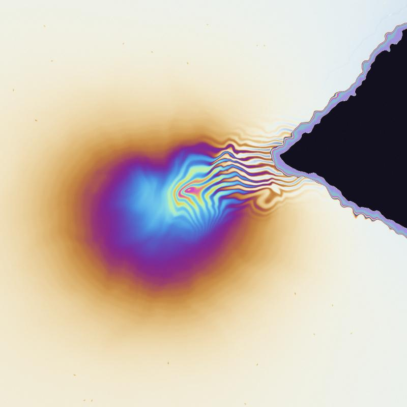

# 里程碑 A：静态薄膜还原

> **改版说明**：本页记录的是该里程碑当时的版本。之后应要求把右侧黑色撕裂区换成了淡粉→淡蓝的躺倒心形 `<3`，并改为 16:9 构图，详见 [E-心形与16比9.md](E-心形与16比9.md)。文中“撕裂区”相关的参数名（`tear*`）在当前代码里已改为 `heart*`。



## 1. 目标与思路

**目标**：不靠手画渐变，只用“厚度 → 物理公式 → 颜色”还原参考图的质感。

**思路**分两层：

1. **厚度场（thickness field）**：给屏幕上每个点算一个数字，表示“这里的膜有多厚”（单位 nm，纳米）。这一层决定**形状**。
2. **干涉着色**：把厚度代入薄膜干涉公式，得到 RGB。这一层决定**颜色**。

关键发现（**事实**，用公式算出来的）：厚度从 0 往上加，反射颜色依次是：

| 厚度 (nm) | 颜色 | 在参考图里对应 |
|---|---|---|
| 0～10 | 黑 | 右侧撕裂区 |
| 20～60 | 灰蓝 | （撕裂边缘的冷灰） |
| 90～110 | 白（一级白） | 近白底色 |
| 120～140 | 奶黄 | 左下暖色底 |
| 150～165 | 金 | 金色光晕 |
| 175～190 | 橙褐 → 红 | 金与紫之间的过渡 |
| 200～215 | 紫 | 深紫环 |
| 220～270 | 蓝 → 青 | 内核的蓝 |
| 300～330 | 黄绿 → 黄 | 内核里的黄 |
| 380 左右 | 品红 | 内核里的品红 |
| 440 左右 | 淡蓝紫 | 撕裂区卷边 |

参考图从外到内正好是这条序列。所以作品的形状设计变成了一件事：**让厚度从背景约 100nm 慢慢升到中心约 330nm，右侧突然掉到 0。**

---

## 2. 整体结构：代码在哪里运行

```
浏览器打开 index.html
  └─ main.js（在 CPU 上运行，JavaScript）
        ├─ 创建 Three.js 渲染器（renderer），拿到一块 <canvas>
        ├─ 放一块铺满屏幕的平面（plane）
        ├─ 给平面一个自写的 ShaderMaterial（着色器材质）
        └─ 每帧：把 CONFIG 的数值传给着色器 → 渲染
              └─ film.frag.glsl（在 GPU 上运行，GLSL 语言）
                    对屏幕上每一个像素各运行一次 main()
```

GPU 的特点是“同时算几百万个像素，但每个像素都跑同一段程序”。所以着色器里没有“画一个圆”这种指令，只有“给定一个坐标，告诉我这一点是什么颜色”。

---

## 3. 代码逐段讲解

### 3.1 [src/config.js](../src/config.js) — 参数集中处

```js
export const CONFIG = {
  optics: { filmIOR: 1.33, wavelengths: [650, 532, 450], ... },
  film:   { baseThickness: 100, ... },
  ...
};
```

- `export const`：声明一个常量并“导出”，别的文件才能 `import` 它。
- 对象（object）用 `{ 键: 值 }` 表示，可以嵌套。`CONFIG.film.baseThickness` 就是一层层取值。
- **执行逻辑**：这个文件本身不做任何事，只是一张参数表。

### 3.2 [src/main.js](../src/main.js) — 搭舞台

**导入**

```js
import * as THREE from 'three';
import fragmentShader from './shaders/film.frag.glsl?raw';
```

- `import * as THREE`：把 three.js 的所有功能装进名为 `THREE` 的对象。
- `?raw` 是 Vite 的特殊写法：把 .glsl 文件当作一整段文字读进来，交给 Three.js 编译。这样不用装额外插件。

**渲染器、相机、平面**

```js
const renderer = new THREE.WebGLRenderer({ canvas, antialias: false });
const camera = new THREE.OrthographicCamera(-1, 1, 1, -1, 0, 1);
const geometry = new THREE.PlaneGeometry(2, 2);
```

- `new`：根据“类（class）”造一个实例。
- 平面 2×2，坐标从 -1 到 1，正好等于屏幕坐标的范围，所以顶点着色器可以直接输出，不需要相机变换。相机只是因为 `renderer.render()` 必须传一个。
- `antialias: false`：抗锯齿是给 3D 模型边缘用的，全屏着色器用不上，关掉省性能。

**自动生成 uniform**

```js
function uniformName(key) {
  return 'u' + key[0].toUpperCase() + key.slice(1);
}
```

- uniform（统一变量）：CPU 传给 GPU 的“全局参数”，对所有像素都一样。
- 这个函数把 `baseThickness` 变成 `uBaseThickness`。`key[0]` 取第一个字母，`.toUpperCase()` 转大写，`key.slice(1)` 取剩下的部分。
- 循环 `for (const [key, v] of Object.entries(CONFIG[group]))` 遍历 CONFIG 里的每一项，自动建 uniform。**好处**：在 CONFIG 加一个参数、在着色器里声明同名 uniform 就能用，不用改 main.js。
- **风险**：名字必须完全对应。拼错时 Three.js 不报错，那个参数只是“没效果”。

**尺寸与像素比**

```js
const ratio = Math.min(window.devicePixelRatio, CONFIG.render.maxPixelRatio) * CONFIG.render.renderScale;
renderer.setPixelRatio(ratio);
```

- devicePixelRatio（设备像素比）：Retina 屏是 2，即 1 个 CSS 像素 = 2×2 个物理像素。
- 限制到 1.5：像素数从 4 倍降到 2.25 倍，省约 44%，肉眼几乎看不出区别。

### 3.3 [src/shaders/film.vert.glsl](../src/shaders/film.vert.glsl) — 顶点着色器

```glsl
gl_Position = vec4(position.xy, 0.0, 1.0);
```

- `vec4`：4 个数字组成的向量。`position.xy` 取 position 的前两个分量（这种写法叫 swizzle，分量重排）。
- 平面只有 4 个顶点，这段只运行 4 次，几乎不花时间。

### 3.4 [src/shaders/film.frag.glsl](../src/shaders/film.frag.glsl) — 核心

#### 第 0 部分：噪声

- **哈希（hash）** `pcg2d`：输入两个整数，输出两个看起来随机的整数。同样输入永远同样输出，所以画面稳定。用了 `uint`（无符号整数）、`^`（按位异或）、`>>`（右移），这些是 WebGL2 才有的语法。
- **梯度噪声（gradient noise）** `gnoise`：在整数网格的每个格点放一个随机方向，格子内部用平滑曲线插值。结果是连续、柔和的起伏。
  - `floor(p)` 向下取整得到格子编号，`fract(p)` 得到格子内的位置（0～1）。
  - `f*f*f*(f*(f*6.0-15.0)+10.0)` 是五次平滑曲线，让格子之间的过渡没有折痕。
  - `mix(a, b, t)` = `a*(1-t) + b*t`，线性混合。
- **fbm（分形布朗运动，fractal Brownian motion）**：把多层噪声叠起来，每层频率约翻倍、振幅减半。大层决定轮廓，小层加细节。
  ```glsl
  for (int i = 0; i < 6; i++) {
    if (float(i) >= octaves) break;
    ...
  }
  ```
  GLSL 要求循环次数在编译时有上限，所以写死 6，再用 `break` 按参数提前退出。

#### 第 1 部分：撕裂区的距离场

**有符号距离场（signed distance field, SDF）**：对每个点返回“离边缘多远”，外面为正、里面为负。用它判断里外，还能知道离边缘多近，方便做卷边。

- 楔形（wedge）= 两个半平面的交集。到一条直线的有符号距离可以用点积 `dot(l, 法线)` 算出来；交集取 `max`。
- 再与一个大圆取 `max`（交集），否则在宽屏上黑色区域会无限向右延伸。
- 边缘加两层噪声 `sd += 噪声`，直线就变成了撕破的锯齿边。

#### 第 2 部分：厚度场 `filmThickness(p)`

这是作品的形状设计。厚度一层层叠加：

| 段落 | 作用 | 对应参考图 |
|---|---|---|
| 2.1 域扭曲 | 先用两层 fbm 算出一个“推动向量” `w2`，再把坐标推歪：`pw = p + 强度 * w2` | 液体般不规则的边缘 |
| 2.2 背景 | 约 100nm，左下略厚、右上略薄，再加微弱云纹 | 左下奶黄、右上冷白 |
| 2.3 光晕 | `pow(1+r², -1.7)` 是长尾巴的隆起；再用 `1-exp(-k·x)` 让中心“饱和”成平台 | 大面积深紫 + 外圈长长的金色过渡 |
| 2.4 流动坐标 | 以内核为中心，头部用“到中心的距离”（同心弧），尾部用“横向距离”（平行线），中间平滑混合 | 流纹绕过头部、再平行流向撕裂区 |
| 2.5 内核 | 沿流动方向拉长的高斯隆起 | 彩虹核心 |
| 2.6 颈部 | 内核到撕裂尖端之间的膜被抽薄 | 颈部偏淡、偏白 |
| 2.7 流纹 | `sin(流动坐标 × 频率 + 噪声)` 得到平行线，噪声让它们分叉、合并 | 细密平行流纹 |
| 2.8 液滴 | 网格里随机放少量小椭圆凸起 | 图上的小斑点 |
| 2.9 撕裂 | 距离场 < 0 处厚度直接变成 2nm；边缘有一条卷边（约 445nm） | 黑色撕裂区 + 淡紫卷边 |

几个关键函数：

- `exp(-x²)`：高斯曲线（Gaussian），中心 1，向外平滑衰减到 0。用来做各种“团”。
- `smoothstep(a, b, x)`：x 从 a 到 b 时，输出从 0 平滑过渡到 1。用来做遮罩（mask）。
- `fwidth(sd)`：sd 在相邻像素之间变化了多少。用它做边缘过渡，宽度恰好约 1 像素：边缘既利落又不会出现锯齿。这就是“厚度突变”。

#### 第 3 部分：薄膜干涉公式

```glsl
float delta = 4.0 * PI * n2 * d * cosT / lambda;
float c = cos(delta);
float num = r12*r12 + r23*r23 + 2.0*r12*r23*c;
float den = 1.0 + r12*r12*r23*r23 + 2.0*r12*r23*c;
return num / den;
```

- **光程差（optical path difference）** = `2 · n · d · cosθt`：光进入膜、到底面反射、再出来，比在顶面直接反射的光多走的路。
- **相位差（phase difference）** `delta` = 2π × 光程差 ÷ 波长。
- `r12`、`r23`：**菲涅尔（Fresnel）振幅系数**，表示每个界面反射多少。肥皂膜两侧都是空气，所以 `r12 = -r23`。负号代表顶面反射多了半个波长的相位翻转，这正是 d≈0 时两束光完全抵消、变成**黑色**的原因。
- 这个分式叫 **Airy 公式**，考虑了光在膜里来回反射无数次的总效果。它比“两束光相加”的简化版更准确，计算量几乎一样。
- **斯涅尔定律（Snell's law）** `sinθt = sinθ / n`：光进膜后会折射，角度变小。
- 每个通道除了代表波长，还在两侧（±`bandwidth`）各算一次，按 1:2:1 平均。真实的红光不是单一波长，这样做颜色更柔和、更像照片。`bandwidth = 0` 时就是严格的三波长算法。
- 最后除以理论最大反射率 `rMax` 做归一化，否则真实的肥皂膜反射率只有约 7%，画面会几乎全黑。

#### 第 4 部分：调色

`曝光 × 白平衡 → 饱和度 → 黑位 → 转 sRGB → 加颗粒`。这些都是对整张画面的统一处理，相当于相机的响应，**不改变颜色从哪里来**。

- `linearToSRGB`：公式算出的是“线性光强”，显示器需要 sRGB 编码。不转换的话，画面会显得又暗又硬。

---

## 4. 与参考图对比

**像的地方**

- 颜色序列完全由物理得出，与参考图一致：白底 → 金 → 深紫 → 蓝/青/黄/品红核心 → 黑色撕裂。
- 撕裂区边缘锐利，有淡蓝紫卷边。
- 右上冷白、左下奶黄的冷暖分布。
- 流纹在核心附近绕成弧，然后成束平行流向撕裂尖端。

**不像的地方**

1. **金色偏褐**：参考图的金是明亮的赭黄，我们的金到紫之间有一段明显的橙褐。这一段在物理上是存在的（Newton 色序里一级橙红），但参考图里它很窄。**推断**：参考照片的相机曲线 / 后期压暗了这一段，或者实际厚度梯度在那里更陡。可调：增大 `blobHaloAmp` 同时缩小 `blobHaloRadius`，让过渡更陡。
2. **核心偏青**：参考图核心更偏淡蓝紫（periwinkle），我们的青色面积偏大。
3. **紫色偏品红**：参考图的深紫更偏靛蓝、更暗。
4. **形状**：参考图的核心是一个开口朝右的“月牙”，边缘有几条大的褶皱；我们的核心更像一团带条纹的云。流纹整体比参考图更规则、更“斑马线”。
5. **颈部**：参考图颈部是大片淡紫白，只夹几条金/紫线；我们的颈部条纹更密。
6. **卷边**：参考图上缘卷边有明显的“一卷一卷”的立体感，我们只是一条宽度变化的带子。
7. **构图**：宽屏时为了不让黑色区域过大，加了 `tearReach` 限制。和正方形参考图相比，宽屏构图是重新设计的，不是 1:1 还原。

## 5. 事实 / 推断 / 不确定

- **事实**：颜色序列由公式计算，表格中的数字是用同一公式离线算出来的。所有颜色都没有手动指定。
- **事实**：在 M4 Max 上 1920×1200 每帧约 2.4ms（用 `readPixels` 强制同步测得）。
- **推断**：参考图的卷边是积液变厚的边，所以我用了较厚的 445nm 而不是很薄的灰边。也可能实际是薄边加上相机白平衡偏紫。两种解释都能得到淡紫色，我无法从一张照片确定。
- **推断**：参考图背景属于“一级白”（约 100nm）。另一种可能是非常厚的膜（几微米），颜色混合后也接近白色。我选择一级白，是因为它能自然地过渡到金色。
- **不确定**：“高级感”是主观判断。我刻意降低了饱和度、去掉了暗角、让面板静止后淡出，但这需要你自己判断。

## 6. 风险

- 每个像素要算约 30 次噪声。集成显卡可能达不到 60fps，需要用画质选项。
- `CONFIG` 的参数之间相互影响（例如 `baseThickness` 改变后，光晕叠加后的颜色也会整体偏移）。建议一次只改一个参数。
