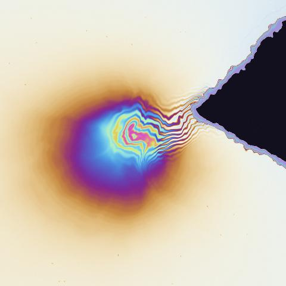

# 里程碑 B：自动流动

> **改版说明**：本页记录的是该里程碑当时的版本。之后应要求把右侧黑色撕裂区换成了淡粉→淡蓝的躺倒心形 `<3`，并改为 16:9 构图，详见 [E-心形与16比9.md](E-心形与16比9.md)。文中“撕裂区”相关的参数名（`tear*`）在当前代码里已改为 `heart*`。



## 1. 目标与思路

**目标**：没有任何输入时，液膜也在缓慢流动、呼吸，但整体构图（光晕、核心、撕裂区的位置）保持稳定。

**思路**：A 阶段的着色器里已经预留了时间变量 `uTime`，所有噪声的采样坐标都加上了 `t × 一个小速度`。B 阶段只需要做三件事：

1. 每帧让 `uTime` 往前走（**流动**）。
2. 用一个很慢的正弦波（LFO，低频振荡器）让几个厚度参数轻轻起伏（**呼吸**）。
3. 页面看不见时停止渲染（**省电**）。

构图之所以稳定，是因为光晕中心、内核中心、撕裂尖端这些“骨架”的坐标不随时间变化，变化的只是噪声，也就是“肉”。

---

## 2. 代码讲解

### 2.1 时间是“累加”出来的，不是“乘”出来的（[main.js](../src/main.js)）

```js
const dt = Math.min((now - lastTime) / 1000, CONFIG.motion.maxDelta);
lastTime = now;
state.flowTime += dt * (CONFIG.motion.flowSpeed + mid * CONFIG.mapping.midFlow);
uniforms.uTime.value = state.flowTime;
```

- `now`：浏览器传给动画回调的当前时间（毫秒）。除以 1000 得到秒。
- `dt`（delta time，帧间隔）：这一帧距上一帧过了多少秒。60fps 时约 0.0167。
- `Math.min(..., maxDelta)`：如果电脑卡了 2 秒，dt 会很大，画面会一下子“跳”过去。限制最大值可以避免。
- **为什么用 `+=` 累加？** 如果写成 `uTime = 真实时间 × 速度`，速度一变（比如 D 阶段中频变大），`uTime` 会瞬间变成另一个数，画面会“瞬移”。累加的写法只会让画面流得更快或更慢，永远连续。这是做声音驱动动画时最常见的坑。

### 2.2 着色器里时间怎么用（[film.frag.glsl](../src/shaders/film.frag.glsl)）

```glsl
vec2 w1 = vec2(fbm(q + vec2(1.7, 9.2) + vec2(0.11, 0.03) * t, ...), ...);
```

- 给噪声的坐标加上 `t × 速度向量`，等于让噪声图案在平面上缓慢平移。
- 两层域扭曲用了**不同方向、不同速度**的平移。叠在一起后看不出“整体平移”，只会看到形状在变化。
- 流纹：`fbm(sc + vec2(-0.35 * t, 0.0))`。`sc.x` 是“沿流动方向的距离”，所以纹理的抖动会**顺着流线**往撕裂区方向漂；`- t * 0.08` 让头部的弧线缓慢向外扩散。

### 2.3 LFO 呼吸

```js
const breath = beat.breath() * beat.state.lfoMix;   // -1 ~ 1
uniforms.uBaseThickness.value = f.baseThickness + breath * m.breathThickness + ...;
uniforms.uBlobHaloAmp.value  = f.blobHaloAmp  + breath * m.breathHalo + ...;
uniforms.uHeartGrow.value    = f.heartGrow    + breath * m.breathHeart + ...;
```

- B 阶段最初的写法是 `Math.sin(时间 / 周期 × 2π)`。到 D 阶段，呼吸移到了 [beat.js](../src/beat.js)：因为有 BPM 时呼吸要和拍子同步，周期会变化，所以相位也改成了累加（与 2.1 是同一个道理）：
  ```js
  s.breathPhase = (s.breathPhase + dt / period) % 1;
  ```
  `% 1` 取小数部分，相位始终在 0～1 之间循环。
- **调制（modulation）模式**：每帧先把 CONFIG 原值抄进 uniform（`syncConfigToUniforms`），再在 `applyModulation` 里加上变化量。CONFIG 本身从不被修改，所以你在 CONFIG 里看到的永远是“基础值”。

### 2.4 页面隐藏时暂停

```js
document.addEventListener('visibilitychange', () => {
  if (document.hidden) stop();
  else start();
  audio.setPaused(document.hidden);
});
```

- `visibilitychange`：切换标签页、最小化窗口时浏览器会触发这个事件。
- `renderer.setAnimationLoop(null)` 停止循环。恢复时 `start()` 会重置 `lastTime`，所以回来后第一帧的 dt 不会是“离开的那几分钟”。
- 浏览器本身也会把后台页面的刷新降到很低，但主动停止更干净，也能顺便挂起音频处理。

---

## 3. 运行检查

页面在后台时无法录屏，所以用像素差来测量运动量：每次渲染整张画面，统计与上一张相比有多少像素发生了明显变化（每通道差值 > 12/255）。

| 间隔 | 平均像素差 | 明显变化的像素占比 |
|---|---|---|
| 1 帧（1/60 秒） | 0.21 / 255 | 0.2% |
| 1 秒 | 4.9 / 255 | 7.7% |
| 10 秒 | 8.1 / 255 | 12.8% |

**结论（事实）**：单帧变化极小，运动是平滑的。变化集中在核心和流纹区域（只占画面约 13%），背景和光晕基本稳定，构图不会漂走。

## 4. 与参考图对比

- 参考图是静止的照片，B 阶段没有“像不像”的直接对比。我的判断标准是：**任意一帧截下来，仍然应该像 A 阶段那张图**。从像素统计看是满足的。
- **不像真实液膜的地方**：真实肥皂膜的流动有方向性（重力向下排液、颜色带缓慢下沉），还有突然的“涌动”。我们的流动是噪声平移，比较均匀、没有因果关系。要更真实需要流体模拟（以后的 ping-pong 缓冲）。

## 5. 风险

- `flowSpeed` 过大（> 2）时，域扭曲会让核心形状变化太快，失去“稳定构图”的感觉。
- 浮点精度：`flowTime` 一直累加，理论上连续运行几天后数值会很大，噪声开始出现块状瑕疵。**推断**：展览级别的长时间运行（> 24 小时）可能需要定期把 `flowTime` 取模，作品集网页不需要担心。
