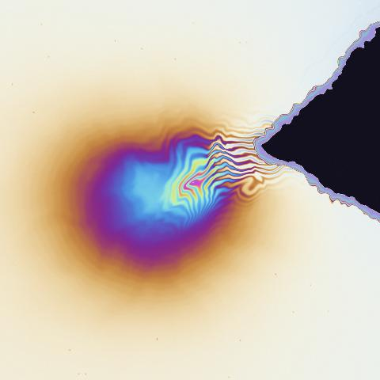

# 里程碑 C：鼠标 / 触屏交互

> **改版说明**：本页记录的是该里程碑当时的版本。之后应要求把右侧黑色撕裂区换成了淡粉→淡蓝的躺倒心形 `<3`，并改为 16:9 构图，详见 [E-心形与16比9.md](E-心形与16比9.md)。文中“撕裂区”相关的参数名（`tear*`）在当前代码里已改为 `heart*`。



## 1. 目标与思路

**目标**：手指或鼠标划过时，附近的液膜被轻轻带动，然后像有黏性的液体一样缓慢回弹。

**思路**：

```
指针移动量 ──(推力)──> 速度 ──(弹簧 + 阻尼)──> 变形量 offset ──> 着色器
指针位置   ──(指数平滑)──> 变形中心 pos                    ──> 着色器
```

着色器里不移动任何“物体”，而是把指针附近的**采样坐标**往反方向挪：原本在左边的图案被“取”到右边来，看起来就像被推向了右边。挪动量随距离按高斯曲线衰减，所以只影响局部。

第一版不做流体模拟：变形不会被“记住”，弹簧回到 0 后画面就完全恢复。以后加 ping-pong 缓冲（两张贴图交替读写，每帧在上一帧的基础上继续变形），才能留下拖尾。

---

## 2. 代码讲解（[src/interaction.js](../src/interaction.js)）

### 2.1 屏幕坐标 → 着色器坐标

```js
let x = (clientX - w / 2) / h;
let y = (h / 2 - clientY) / h;
```

- `clientX/clientY`：鼠标在窗口里的像素位置，原点在左上角，y 向下。
- 着色器的坐标原点在屏幕中心，以屏幕高度为 1，y 向上。所以要减去一半、除以高度，并翻转 y。
- 后面的宽屏 / 竖屏处理必须与着色器 `main()` 里的写法**完全一致**，否则变形会出现在离手指有一段距离的地方。**风险**：以后改了着色器的构图逻辑，必须同步改这里。

### 2.2 Pointer Events：一套代码同时支持鼠标和触屏

```js
element.addEventListener('pointermove', onMove);
element.addEventListener('pointerdown', (e) => { ... });
```

- Pointer Events（指针事件）把鼠标、手指、手写笔统一成一种事件。
- CSS 里的 `touch-action: none` 很重要：没有它，手机上拖动会变成滚动或缩放页面。
- 手指刚按下时 `hasPointer = false`，第一次 `onMove` 直接把中心跳到手指位置、**不产生推力**。否则手指从上一次抬起的地方“瞬移”过来，会被当成一次巨大的甩动。

### 2.3 指数平滑（exponential smoothing）

```js
const follow = 1 - Math.exp(-dt / c.followTime);
s.pos.x += (s.target.x - s.pos.x) * follow;
```

- 每帧向目标靠近“剩余距离的一部分”。
- 为什么用 `1 - exp(-dt/τ)` 而不是固定的 0.1？固定比例在 120Hz 屏幕上的跟随速度是 60Hz 屏幕的两倍。用这个公式，无论帧率多少，经过 τ 秒都会走完约 63% 的距离。`τ`（tau）就是 `followTime`。

### 2.4 弹簧（spring）

```js
s.vel.x += s.impulse.x * c.impulseGain;          // 推力 -> 速度
const ax = -c.stiffness * s.offset.x - c.damping * s.vel.x;  // 加速度
s.vel.x += ax * dt;                               // 先更新速度
s.offset.x += s.vel.x * dt;                       // 再用新速度更新位置
```

- **胡克定律（Hooke's law）**：拉回力 = -硬度 × 位移。位移越大，往回拉得越用力。
- **阻尼（damping）**：-阻尼 × 速度，像在蜂蜜里运动，速度越快阻力越大。
- 先更新速度、再用新速度更新位置，这叫**半隐式欧拉（semi-implicit Euler）**积分。它比“先位置后速度”更稳定，不容易越弹越大。
- 阻尼比（damping ratio）ζ = damping / (2√stiffness) = 3.2 / (2×√6) ≈ 0.65：小于 1，所以回弹时有一点点过冲，但不会来回晃很多次。改 `damping` 能直接看到差别：< 2 会晃，> 6 会缓慢地、不晃地回去。

### 2.5 着色器里的变形（[film.frag.glsl](../src/shaders/film.frag.glsl) 第 2.0 段）

```glsl
vec2 dpt = p - uPointer;
float fall = exp(-dot(dpt, dpt) / (uPointerRadius * uPointerRadius));
p -= uPointerOffset * fall;
```

- `dot(dpt, dpt)` = 距离的平方。`exp(-d²/R²)` 是高斯衰减：指针正下方为 1，离开约 2 个半径后几乎为 0。
- 这一步在厚度场的**最开始**进行，所以后面所有东西（光晕、流纹、撕裂边缘）都会一起被推动。
- 另外 `h += uPointerThicken * push * ...` 让指针处的膜略微变厚（像液体被推得堆起来），颜色会往“更厚”的方向偏一点。

---

## 3. 运行检查

模拟一次快速向右拖动（12 帧移动约 0.18 个屏幕高度），之后不再移动，逐帧记录变形量：

| 时间 | 变形量 |
|---|---|
| 拖动结束 | 0.029 |
| 0.5 秒 | 0.048（接近上限 0.05） |
| 1.5 秒 | 0.0024 |
| 4 秒 | 0.0002（已完全回弹） |

**事实**：变形先增大（速度还在推）、再平滑回到 0，没有失控。在核心上拖动的截图（本页顶部）中，条纹被带向右下方，幅度很小，符合“轻微”的要求。

**没测到的（不确定）**：我只能用程序模拟鼠标事件，没有在真实触屏设备上测试。手机上手指会遮住变形的地方，`radius` 可能需要调大才看得出效果。

## 4. 与参考图对比

参考图是静止的，没有交互可以对比。视觉上的判断：推动后条纹会“弯一下”，这一点和真实薄膜被气流吹动时类似。但真实薄膜被推动后，颜色带会被永久地拉长、混合，不会回弹。这正是以后的流体模拟（ping-pong）要解决的问题。

## 5. 风险

- **快速甩动会碰到 `maxOffset` 上限**，此时变形会在上限停留一会儿再回弹，看起来有点“卡”。可以加大 `maxOffset` 或减小 `impulseGain`。
- 变形是“挪坐标”，挪得过大时撕裂区的锐利边缘也会被扯动。`maxOffset` 0.05 以内是安全的，超过 0.1 可能出现撕裂边缘被拉成奇怪的形状。
- 面板（panel）挡住的区域不会触发交互，这是故意的：面板上的事件不会传到画布。
