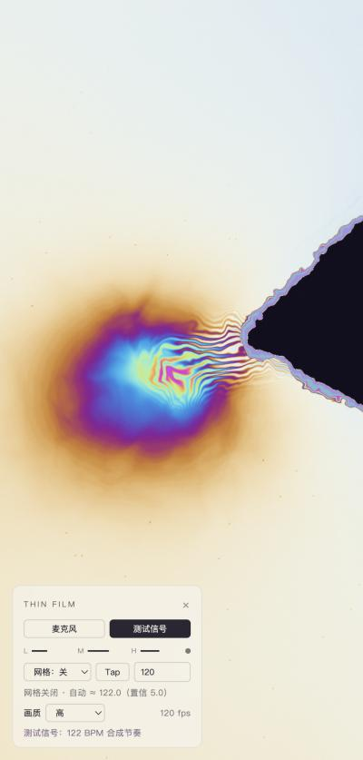

# 里程碑 D：麦克风与节拍

> **改版说明**：本页记录的是该里程碑当时的版本。之后应要求把右侧黑色撕裂区换成了淡粉→淡蓝的躺倒心形 `<3`，并改为 16:9 构图，详见 [E-心形与16比9.md](E-心形与16比9.md)。文中“撕裂区”相关的参数名（`tear*`）在当前代码里已改为 `heart*`。



## 1. 目标与思路

**目标**：用电脑麦克风“听”正在播放的音乐，让画面跟着低音、中音、高音和鼓点变化；没有声音时保持缓慢呼吸。

**数据流**：

```
麦克风 ──> AnalyserNode（FFT，快速傅里叶变换）──> 每帧 1024 个频率格子的音量
   │
   ├─> 低 / 中 / 高 三个频段的能量 ─> 自适应增益 ─> attack/release 平滑 ─> 三个 0~1 的数
   │                                                                        │
   └─> 频谱通量（spectral flux）─> 起拍检测 ─> 脉冲 ─┐                     │
                                    └─> 自动 BPM ─┐  │                     │
                     Tap / 手动输入 BPM ──────────┴─> 节拍网格 ─> 脉冲     │
                                                                  ↓         ↓
                                                  applyModulation：改着色器参数
```

**映射**：

| 输入 | 驱动 | CONFIG.mapping |
|---|---|---|
| 低频（30～160Hz，底鼓、贝斯） | 心形大小、整体厚度起伏 | `lowHeart`, `lowThickness` |
| 中频（160～2200Hz，人声、和弦） | 流动速度、扭曲强度 | `midFlow`, `midWarp` |
| 高频（2200～11000Hz，镲片） | 细纹密度 | `highStreak` |
| 起拍 / 节拍网格脉冲 | 光晕、内核、心形“跳一下” | `pulseHalo`, `pulseCore`, `pulseHeart` |
| 没有声音 | LFO 呼吸 | `CONFIG.motion.breath*` |

---

## 2. 代码讲解

### 2.1 获取麦克风（[audio.js](../src/audio.js) `startMic`）

```js
s.stream = await navigator.mediaDevices.getUserMedia({
  audio: { echoCancellation: false, noiseSuppression: false, autoGainControl: false },
  video: false,
});
s.trackSettings = s.stream.getAudioTracks()[0].getSettings();
```

- `getUserMedia`：请求摄像头 / 麦克风权限。浏览器会弹窗询问。只在 `https://` 或 `localhost` 下可用。
- 三个 `false`：浏览器默认把麦克风当作“打电话”用，会自动消除回声（把扬声器放出来的音乐当回声消掉！）、降噪（把持续的和弦当噪声压掉）、自动增益（把强弱拉平）。三个都关掉，才能听到原本的音乐。
- `await`：等待一个需要时间的操作（用户点“允许”）完成再继续。只能在 `async` 函数里用。
- `getSettings()`：浏览器**实际**采用的设置。我们请求关闭，浏览器不一定照做，所以要检查。面板会提示“注意：浏览器仍开启了 …”。
- `AudioContext` 必须在用户点击之后创建 / 恢复，这是浏览器的自动播放策略。所以麦克风由按钮开启，不能在页面加载时自动开启。
- 麦克风只接到分析器（analyser），**不接扬声器**，否则会形成“麦克风 → 扬声器 → 麦克风”的啸叫。

### 2.2 FFT 与频段能量（`update`）

```js
s.analyser.getFloatFrequencyData(s.db);           // 每个格子的分贝值
const binHz = s.ctx.sampleRate / s.analyser.fftSize;
...
const mag = Math.pow(10, s.db[i] / 20);           // 分贝 -> 振幅
sum += mag * mag;                                 // 振幅² = 功率
```

- **FFT**：把一小段声音波形拆成“每个频率有多响”。`fftSize = 2048` 时得到 1024 个格子（bin）。采样率 48000Hz 时，每个格子宽约 23Hz。
- `smoothingTimeConstant = 0`：关掉分析器自带的平滑，因为频谱通量需要“原始”的帧间变化，平滑由我们自己做。
- **分贝（dB）**是对数单位：每 +20dB 振幅变为 10 倍。`10^(dB/20)` 把它变回线性振幅。

### 2.3 自适应增益（adaptive gain）

```js
const levelDb = 10 * Math.log10(s.raw[b] + 1e-12);
s.peakDb[b] = Math.max(levelDb, s.peakDb[b] - a.peakFallDb * dt, a.gateDb + a.rangeDb * 0.5);
target = 1 - (s.peakDb[b] - levelDb) / a.rangeDb;   // 限制到 0~1
```

- 每个频段记住最近的“峰值”。遇到更响的立刻更新；否则每秒回落 `peakFallDb` 分贝。
- 输出 = 当前比峰值低多少，除以动态范围 `rangeDb`。比峰值低 24dB 就是 0，等于峰值就是 1。
- **好处**：音乐整体大声还是小声，三个值都会落在 0～1，画面不会因为音量旋钮而失效。
- 第三个参数 `gateDb + rangeDb * 0.5` 是峰值的下限：安静房间里刚过噪声门的底噪不会被放大成满格。
- **开发中发现并修复的问题（事实）**：第一版在**线性功率**上做归一化，噪声门设在约 -31dB。实测测试信号的中频峰值只有 -36.5dB、高频只有 -58.8dB，全被门挡住，中、高频永远是 0。而且线性比值太“压缩”：比峰值低 10dB 只剩 0.1。改为在分贝域做归一化后，三个频段的平均值约 0.5，范围 0.1～0.85。

### 2.4 attack / release 平滑

```js
const tau = target > s.bands[b] ? a.attack[b] : a.release[b];
s.bands[b] += (target - s.bands[b]) * (1 - Math.exp(-dt / tau));
```

- 与 C 阶段的指数平滑是同一个公式，区别是上升和下降用不同的时间常数：
  - **attack**（起音，0.03～0.06 秒）：上升快，鼓点一来马上反应。
  - **release**（释音，0.35～0.6 秒）：下降慢，留一点余韵，画面不会一抽一抽的。

### 2.5 频谱通量（spectral flux）

```js
const n = (s.db[i] - fluxMinDb) / (fluxMaxDb - fluxMinDb);  // 映射到 0~1
const d = n - s.prevNorm[i];
if (d > 0) flux += d;      // 只累加“变响”的部分
```

- 比较这一帧和上一帧的频谱，统计所有频率“变响了多少”。鼓点、拨弦这类突然出现的声音会让很多格子同时变响，通量会突然变大。
- 只算变响（`d > 0`，叫半波整流，half-wave rectification）：声音变轻不代表新音符。

### 2.6 起拍检测（[beat.js](../src/beat.js)）

```js
s.threshold = Math.max(mean + c.threshold * std, c.minFlux);
if (flux > s.threshold && flux > s.prevFlux && t - s.lastOnset > c.minInterval) { onset = true; ... }
```

- 阈值是**自适应**的：最近约 0.75 秒通量的平均值 + 1.6 倍标准差（standard deviation，衡量波动大小）。安静段落阈值低，吵闹段落阈值高。
- `flux > prevFlux`：只在上升沿触发，同一个鼓点不会连续触发好几帧。
- `minInterval` 0.13 秒：两次起拍至少间隔这么久。
- 触发后 `onsetPulse` 跳到 0.45～1（超出阈值越多越强），再按 `pulseDecay` 指数衰减。

### 2.7 自动 BPM（实验）

**梳状打分（comb scoring）**：取最近 8 秒所有起拍，两两算时间间隔。对 75～170 之间每个候选 BPM，检查有多少间隔恰好是它的 1、2、3、4 拍（允许约 ±20ms 误差，用高斯打分）。得分最高的就是估计值。

- 每 0.5 秒算一次，计算量约几十万次乘法，可以忽略。
- 防抖：新估计与旧值相差 3 BPM 以上时，要连续出现两次才采纳。
- 置信度 = 最高分 ÷ 平均分。约 1 表示没有明显节奏，> 3 表示比较确定。
- **已知缺陷**：经常把 140 识别成 70（超出范围时会落到 140/2=70 附近），或者把 90 识别成 180。这就是“半速 / 倍速错误”，所以标注为实验功能。

### 2.8 Tap tempo、手动 BPM、节拍网格

```js
s.tapBpm = 60 * (taps.length - 1) / (最后一次 - 第一次);   // 平均间隔换算成 BPM
...
s.phase += dt * bpm / 60;                                // 每过一拍相位 +1
if (Math.floor(s.phase) !== before) s.gridPulse = 1;      // 跨过整数 = 新的一拍
if (onset && |相位误差| < 0.25) s.phase -= 误差 * phaseLock;  // 向真实鼓点靠拢
```

- Tap：保留最近 8 次点按，停顿超过 2 秒就重新开始。用“首尾时间差 ÷ 间隔数”，比逐个平均更稳。
- 节拍网格：有 BPM 后，按拍子产生较弱的脉冲（`gridPulse` 0.6 倍）。真实鼓点出现在某拍附近时，相位往那一拍拉一点（`phaseLock`），这是一个简化的锁相环（PLL，phase-locked loop）。
- 最终脉冲 = 鼓点脉冲与网格脉冲取较大者。

### 2.9 没有声音时：LFO

```js
const silent = !audioOn || silentFor > CONFIG.audio.silenceTime;
s.lfoMix += ((silent ? 1 : 0.25) - s.lfoMix) * (1 - Math.exp(-dt / 1.5));
const period = b > 0 ? (60 / b) * 16 : CONFIG.motion.breathPeriod;
```

- 没开麦克风，或安静超过 1.5 秒：呼吸占满。有声音时呼吸只保留 25%，主要由声音驱动。两者之间约 1.5 秒交叉淡化。
- 有 BPM 时呼吸周期 = 16 拍（120 BPM 时 8 秒），与音乐同步但仍然缓慢。

### 2.10 映射到画面（[main.js](../src/main.js) `applyModulation`）

```js
uniforms.uHeartGrow.value  = f.heartGrow + breath * m.breathHeart + low * k.lowHeart + pulse * k.pulseHeart;
uniforms.uWarpAmount.value = f.warpAmount + mid * k.midWarp;
uniforms.uStreakFreq.value = f.streakFreq * (1 + high * k.highStreak);
state.flowTime += dt * (CONFIG.motion.flowSpeed + mid * CONFIG.mapping.midFlow);  // 在 frame() 里
```

所有声音驱动都是“基础值 + 变化量”，基础值来自 CONFIG，变化量来自声音。流动速度通过累加的 `flowTime` 改变，不会让画面瞬移（见 B 阶段）。

### 2.11 测试信号

`startTest()` 用 Web Audio 合成一段 122 BPM 的节奏：每拍底鼓（正弦波快速降调）、2、4 拍军鼓（带通滤波噪声）、反拍镲片（高通噪声），加一个缓慢起伏的锯齿波和弦。调度器每 25ms 把未来 0.12 秒内的音符提前安排进音频时钟，这样节奏不会因为 JavaScript 定时器的抖动而变得不稳。

它有两个用途：在没有麦克风的环境里检验整条链路；展示时没有音乐也能演示声音效果。

---

## 3. 运行检查

| 检查项 | 结果 |
|---|---|
| 测试信号的自动 BPM | **122.0**（真实值 122），置信度 4.8～5.6 |
| 起拍数量 | 8 秒窗口内 25 次，约每秒 3 次（底鼓每秒 2 次 + 军鼓每秒 1 次，镲片大多未触发，符合预期） |
| 三频段（修复后） | 平均约 0.46 / 0.55 / 0.44，最小约 0.1，最大约 0.85 |
| 无声音时 | 三频段为 0，LFO 占比升到约 1 |
| Tap（每 0.5 秒点一次，共 5 次） | 119.8 BPM（误差来自定时器抖动） |
| 节拍网格（119.8 BPM，模拟 4 秒） | 7 次网格节拍，7 次脉冲（理论 8.0，差 1 是起始相位造成的） |
| 帧率（播放测试信号时，本机） | 面板显示 120fps（ProMotion 屏） |

**没测到的（重要）**：开发时用的内置浏览器禁止访问麦克风，所以**真实麦克风这条路径没有实际运行过**。代码逻辑与测试信号共用同一套分析，但以下几点需要你在 Chrome 里亲自确认：

1. 点「麦克风」后浏览器是否弹出权限窗口，面板是否显示“通话处理已关闭”。
2. 用电脑扬声器放音乐时，三条电平是否都有动静。笔记本内置麦克风对低频（< 100Hz）很不灵敏，**推断** L 条可能偏弱，可以把 `lowBand` 改成 `[60, 250]`。
3. 环境噪声大时把 `gateDb` 调高（如 -65）。

## 4. 与参考图对比

参考图是静止的，“声音驱动”无法直接对比。我的审美判断：映射的幅度刻意设得小，鼓点只让紫色环“跳”约 14nm，心形胖约 0.006 个屏幕高度。这样声音是让画面“有呼吸”，而不是变成随音乐乱闪的可视化器。如果你想要更强烈的反应，调大 `CONFIG.mapping` 里的数值。

## 5. 风险

- **高频驱动细纹密度会让纹路“游动”**：频率改变时，离中心越远的纹路相位变化越大，看起来像在收缩或扩张。`highStreak` 设为 0.3，并给高频 0.45 秒的 release 来缓和。如果觉得晃，调小 `highStreak`。
- **浏览器差异**：Safari 和 Firefox 可能忽略关闭降噪的请求。macOS 的“人声突显”麦克风模式是系统级的，网页关不掉。
- **起拍检测依赖帧率**：分析在每帧动画里进行，帧率掉到 30fps 时，通量的时间分辨率也会减半，快速的鼓点（如 16 分音符）可能漏检。
- **自动 BPM**：见 2.7，不适合非电子乐。建议现场演示时用 Tap。
