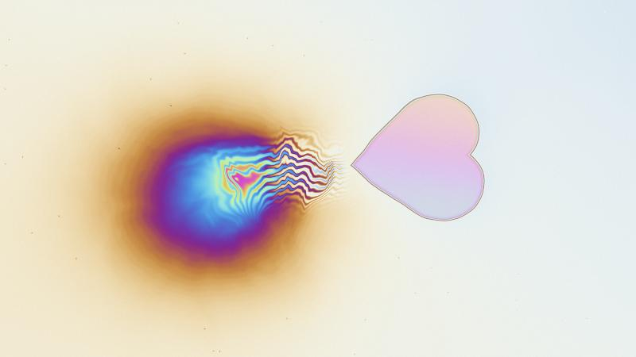

# 改版 E：躺倒的心形 `<3` 与 16:9 构图

> **改版说明**：之后又改成了羽化边缘、边缘汇流、放大到接近全屏再倒放，详见 [F-羽化放大与挤压.md](F-羽化放大与挤压.md)。本页 2.3 的细彩色轮廓线和 2.4 的“随时间追赶”式拖拽已被替换（`heartRim`、`heartDrift*`、`heartLeadTime`、`heartTrailTime` 不再存在）。



## 1. 需求

1. 画面比例改成 1920×1080（16:9）。
2. 右侧黑色三角（撕裂区）换成**淡粉 → 淡蓝渐变**。
3. 形状改成**躺倒的心形 `<3`**：尖端朝左，心瓣朝右。
4. 心形**缓缓向左漂移，带拖拽感（lagging）**。

## 2. 思路与取舍

### 2.1 颜色仍然来自厚度，但这次需要多一步

先离线扫描了 0～1600nm 所有厚度对应的颜色（**事实**）：

- 二级色序里 **370nm ≈ 粉、410nm ≈ 品红紫、440nm ≈ 淡紫蓝、457nm ≈ 天蓝**，从粉到蓝是连续的一段，中间经过淡紫。
- 但这一段的颜色很**艳**，不“淡”。整个色序里找不到一段“淡粉 → 淡蓝”且中间不经过黄绿或米色的厚度区间。

于是心形用了两层：

1. **厚度渐变**：心形内部厚度从 370nm（上方）平滑过渡到 457nm（下方），加一点缓慢流动的起伏。颜色仍然由干涉公式算出。
2. **背光提亮（veil）**：`col = mix(干涉色, 白, 0.58)`。物理上的解释：心形区域的薄膜后面像有一面亮墙，透过来的白光叠加在反射色上，颜色就变成了粉彩。

**需要你知道的取舍**：第 2 步是对一块区域统一做的“提亮”，不是从厚度推出来的。它没有手填颜色（粉、蓝仍然来自厚度），但如果严格要求“只有厚度 → 颜色”，这一步越界了。设 `heartVeil: 0` 就能看到纯物理的结果：更艳的粉、紫、蓝。

### 2.2 心形 = 菱形 + 两个圆

```glsl
float diamond = (abs(q.x) + abs(q.y) - a) * 0.70710678;
float lobeL = length(q - vec2(-0.5 * a, 0.5 * a)) - r;
float lobeR = length(q - vec2( 0.5 * a, 0.5 * a)) - r;
return min(diamond, min(lobeL, lobeR));
```

- `abs(x) + abs(y) = a` 是一个旋转 45° 的正方形（菱形），乘 0.707 把它变成真正的距离。
- 两个圆的圆心在菱形上面两条边的中点，半径是半条边长。它们刚好经过菱形的角，鼓出两个心瓣，上方的角变成心形的凹口。
- `min` = 并集（union）：在任何一个形状里面，就算在心形里面。
- 先按“尖朝下”的标准姿势算，再把坐标旋转：标准姿势的“上”对应屏幕的“右”。于是尖端朝左，形成 `<3`。

### 2.3 边缘：一条细的彩色轮廓线

```glsl
float inside = smoothstep(uHeartRim, -uHeartRim, sd);
h = mix(h, hHeart, inside);
```

在约 5 像素宽的过渡带里，厚度从外面的约 100nm 升到里面的约 370nm，正好扫过金、褐、紫、蓝。所以轮廓自然是一条极细的彩虹线。背光提亮也覆盖到轮廓的一半，让它是“细腻的彩边”而不是“黑描边”。

### 2.4 拖拽感：两个以不同速度追赶同一目标的点（[main.js](../src/main.js) `applyHeart`）

```js
const kl = 1 - Math.exp(-dt / m.heartLeadTime);   // 尖端：0.8 秒
const kt = 1 - Math.exp(-dt / m.heartTrailTime);  // 心瓣：6 秒
heart.lead[0]  += (tx - heart.lead[0])  * kl;
heart.trail[0] += (tx - heart.trail[0]) * kt;
```

- 目标 `tx` 在一个 44 秒的周期里：62% 的时间缓缓向左，其余时间缓缓退回（不退回的话心形会漂出画面）。
- 尖端和心瓣都用 C 阶段学过的指数平滑去追目标，但延迟不同。移动时尖端先到、心瓣落后。
- 着色器里，每个点根据它在心形里的位置（靠近尖端还是心瓣）在两者之间插值：
  ```glsl
  float w = smoothstep(-0.2 * a, 2.2 * a, x0);   // 0 = 尖端附近，1 = 心瓣末端
  vec2 tip = mix(uHeartLead, uHeartTrail, w);
  ```
  于是向左移动时心形会被轻微拉长，停下时再慢慢收回。
- 色团流出的流纹始终指向**尖端的当前位置**，所以心形漂移时流纹会跟着转向。

### 2.5 16:9 构图

```glsl
float aspect = uResolution.x / uResolution.y;
if (aspect < uFrameAspect) p *= uFrameAspect / aspect;
```

- 所有位置都按 16:9 画框设计（x 约 -0.89～0.89，y 为 -0.5～0.5）。色团在左偏中，心形在右侧。
- 比 16:9 更宽的屏幕：高度对齐，两侧多露出一些底色。
- 比 16:9 更窄的屏幕（方屏、竖屏手机）：整体缩小，保证画框宽度完整可见，上下多露出底色。
- 没有加黑边（letterbox），画面始终铺满窗口。
- 鼠标坐标换算（[interaction.js](../src/interaction.js)）同步改了，否则变形会偏离手指位置。

## 3. 运行检查

| 检查项 | 结果 |
|---|---|
| 1920×1080 视口 | 构图正常，无报错 |
| 心形颜色 | 上方淡粉 → 中间淡紫 → 下方淡蓝 |
| 拖拽量（模拟 88 秒） | 向左漂移时心瓣最多落后尖端 0.034（心形长约 0.33，约 10% 拉伸）；退回时最多 0.046 |
| 开发中发现的 bug（已修） | 心形内侧变亮的 `exp(sd/…)` 在远处溢出成无穷大，`mix(h, -inf, 0)` 得到 NaN，左侧两个角出现黑块。改为 `exp(min(sd, 0)/…)` |

## 4. 风险与不确定

- **“向左 lagging”是我的理解**：我做成了“缓缓向左、心瓣拖在后面、周期性慢慢退回”。如果你想要的是**一直向左、不回来**（比如从右边进入、从左边消失、循环），需要换成另一种运动方式，告诉我即可。
- **退回时的拖拽比向左时更明显**（0.046 对 0.034），因为退回用的时间更短。想让退回更不显眼，把 `heartDriftLeftShare` 调小（如 0.5），但那样向左的拖拽也会变弱。
- 心形是很“图形化”的符号，和薄膜的有机质感之间有张力。我用了轻微的边缘起伏（`heartEdgeNoise`）和内部流动纹理来缓和；完全几何的心形设 `heartEdgeNoise: 0`。
- 参考图的黑色撕裂区去掉后，画面没有了最深的暗部，整体对比度降低。**推断**：画面会更柔、更甜，但少了参考图那种“破裂”的张力。这是审美方向的改变，不是 bug。
