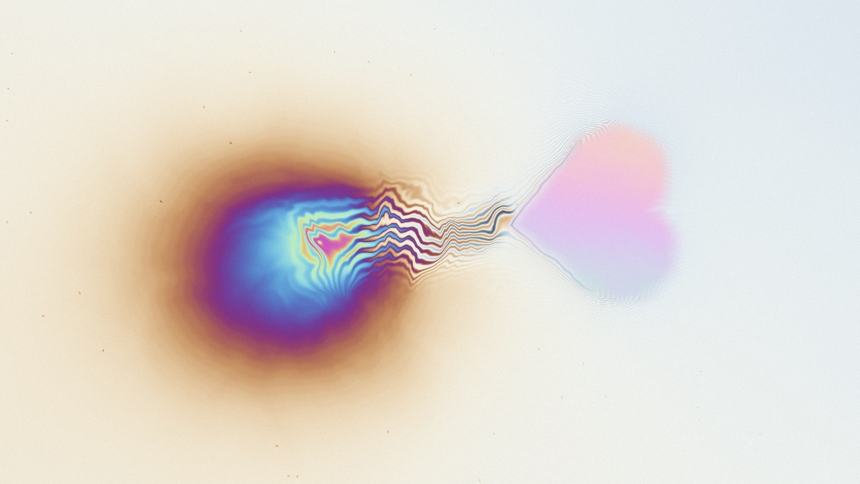
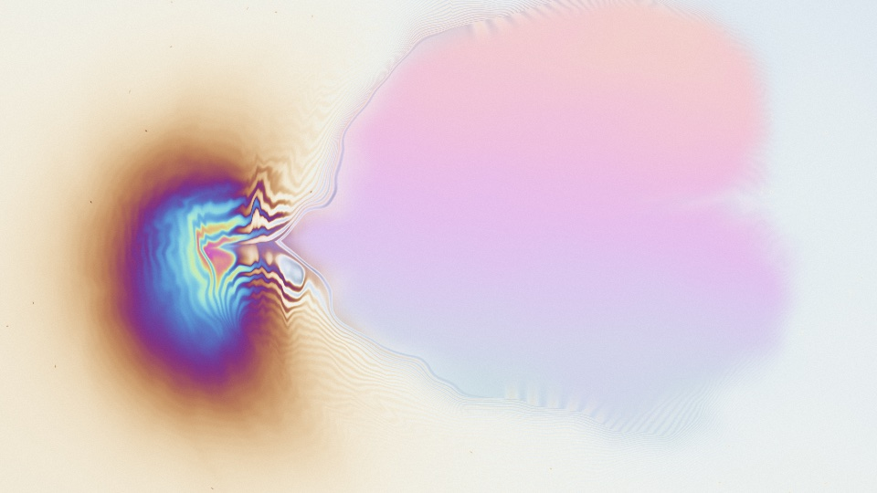
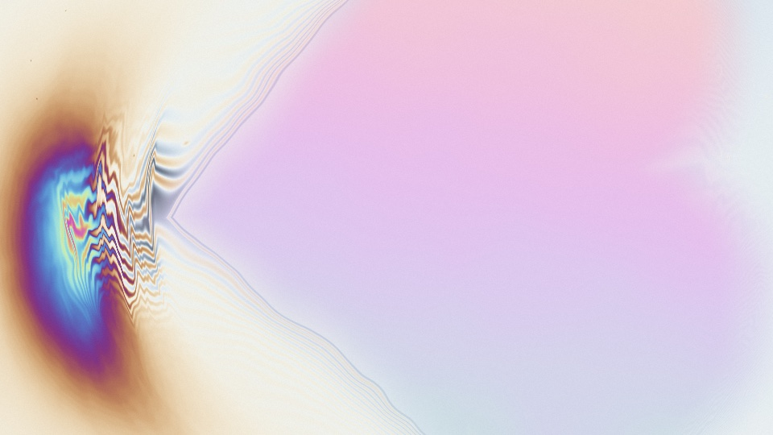

# 改版 F：羽化边缘、边缘汇流、放大倒放、挤压

| 原样（进度 0） | 放大一半（0.5） | 接近全屏（1） |
|---|---|---|
|  |  |  |

## 1. 需求

1. 心形边缘**羽化 30%**，再加一点随机波动。
2. 色团流过来的带子和心形之间**没衔接上**：要让心形的边缘流淌出去，汇成左边一条条的带子。
3. 左边（心形以外）的紫色和黄色**饱和度再降 30%**。
4. 心形**慢慢放大变形到接近全屏，再倒放回原样**。
5. 放大时左边的薄膜**不消失，只是被挤压变形**。

## 2. 思路与代码

### 2.1 羽化：两种厚度、两种颜色、一张遮罩

之前心形边缘是“厚度突变”，突变带里厚度扫过金、紫、蓝，所以是一条彩色描边，没法真正变虚。

现在厚度场返回三样东西（[film.frag.glsl](../src/shaders/film.frag.glsl) `struct Film`）：

```glsl
struct Film {
  float hOut;   // 心形外的厚度
  float hIn;    // 心形内的厚度
  float mask;   // 0 = 外，1 = 内，边缘是羽化过渡
};
```

`main()` 里两种厚度**各自**算干涉色，再按遮罩混合：

```glsl
vec3 colOut = filmColor(f.hOut);                       // 外：干涉色
vec3 colIn  = mix(filmColor(f.hIn), vec3(1.0), uHeartVeil); // 内：干涉色 + 背光提亮
vec3 col    = mix(colOut, colIn, f.mask);              // 羽化混合
```

- `struct`（结构体）：把几个变量打包成一个，函数一次就能返回多个值。
- 羽化宽度 = `heartFeather × 心形大小`，默认 0.3，即 30%。心形放大时羽化也一起变宽，看起来比例不变。
- **说明**：“30%”是按“尖端到心形中心的距离”算的。如果你觉得太虚或不够虚，直接改 `heartFeather`。

### 2.2 边缘随机波动 + 放大时的变形

```glsl
sd += uHeartEdgeNoise * a * fbm(ln * 2.2 + ... + 0.06 * t, 3.0);                 // 随时间轻轻抖
sd += uHeartDeform * a * sin(PI * progress) * fbm(ln * 1.1 + ... + progress * 0.8, 3.0); // 随放大进度变形
```

- `ln = local / a`：按心形大小归一化的坐标。噪声跟着心形一起放大，不会出现“心形变大、纹理不变”的错位感。
- 第二行只取决于放大进度 `progress`，不取决于时间，所以缩回时会原路返回。`sin(π·progress)` 在 0 和 1 时为 0，一半时最大：开始和结束都是规整的心形，中途最“液体”。

### 2.3 边缘汇流：心形的等距线在尖端处变成带子

```glsl
float wHeart = exp(-sdOut / (0.03 + 0.05 * a)) * mix(0.06, 1.0, nearTip);
float heartCoord = sdOut * 1.6;
float flowCoord = mix(streamCoord, heartCoord, clamp(wHeart * 1.3, 0.0, 1.0));
float lines = sin(flowCoord * 频率 + 噪声 - t * (0.08 + 0.35 * wHeart));
```

- `sdOut` 是“到心形边缘的距离”。`sin(sdOut × 频率)` 画出来就是一圈圈和心形平行的轮廓线，像水波。
- 在尖端左边，这些等距线自然变成 `<<<` 形（到一个尖角的等距线就是这样）。
- 靠近心形用“到心形的距离”当流纹坐标，靠近色团用原来的流动坐标，中间按权重 `wHeart` 混合。两套线条在尖端附近平滑地接在一起，于是色团的带子看起来就是从心形边缘流出来的。
- `- t * 0.35 * wHeart`：靠近心形的线不断向外移动，像液体从边缘流淌出去。
- `nearTip`：尖端一侧强、心瓣一侧弱（只剩 6%），避免整个心形被一圈圈条纹包住。

### 2.4 左边饱和度降低 30%

```glsl
colOut = mix(vec3(lumOut), colOut, uOutsideSaturation);   // 0.7
```

`mix(灰度, 原色, 0.7)` 就是保留 70% 的色彩，即降低 30%。这一步只作用于心形以外，心形本身的粉蓝不受影响。之后还有全局的 `saturation`（0.95）。

### 2.5 放大与倒放（[main.js](../src/main.js) `heartProgress` / `applyHeart`）

```js
// 停在原样 -> 放大 -> 停在最大 -> 缩回
if (phase < rest) return 0;
if (phase < rest + move) return ease((phase - rest) / move);
if (phase < rest + move + full) return 1;
return 1 - ease(...);
```

- 进度 `g` 从 0 到 1 再回到 0。缩回段用的是同一个 `ease` 曲线的镜像，所以速度曲线对称。
- 心形的大小、位置、尖端领先量、有机变形**全部只由 `g` 决定**：
  ```js
  const gLead = ease(Math.min(g * (1 + m.heartTipLead), 1));  // 尖端提前到达 -> 放大途中被拉长
  const size  = lerp(f.heartSize, m.heartMaxSize, g);
  ```
  所以缩回是放大的**精确倒放**。（上一版的“拖拽”用了随时间追赶的平滑，有惯性，倒回去时形状会不一样，所以这次改成了只依赖进度的写法。）
- `lerp(a, b, k)`：线性插值，k=0 得 a，k=1 得 b。

### 2.6 挤压：外面的薄膜被压缩到剩下的空间

```glsl
if (rho < R1)        ps = c0 + dirV * rho * (R0 / R1);
else if (rho < rFar) ps = mix(c0, c1, …) + dirV * (R0 + (rho - R1) * (rFar - R0) / (rFar - R1));
else                 ps = p;
```

- 以心形中心为原点看每个点：它离中心多远（`rho`），在哪个方向（`dirV`）。
- 规定：“放大后的心形边缘”（R1）去读“原来心形边缘”（R0）处的内容，很远处（rFar）读它自己，中间线性过渡。
- 色团、光晕、流纹、背景全都用压缩后的坐标 `ps` 计算，所以它们原本被心形覆盖的部分被“推”到了外面，整体变扁变密，而不是被盖住。
- 进度为 0 时 R1 = R0、c1 = c0，公式退化成 `ps = p`，画面和原来完全一样。

## 3. 运行检查

| 检查项 | 结果 |
|---|---|
| 进度 0 / 0.5 / 1 三张截图 | 见本页顶部。羽化、汇流、挤压都生效，没有黑块或报错 |
| 倒放精确性（事实） | 放大途中与缩回途中进度同为 0.216 时，在同一背景时间下逐像素比较，最大差值 **0** |
| 性能 | 2880×1620（1920×1080 × 1.5）每帧 3.26ms（之前 2.4ms），本机仍有很大余量 |
| 截图方式 | 内置浏览器的截图在 1920×1080 模拟视口下失灵，改为直接导出画布像素 |

第一次的截图里，心形四周的轮廓线范围太大、太密，整个画面都是斑马纹。已收窄到尖端附近（衰减距离从 0.09+0.15a 缩到 0.03+0.05a，心瓣一侧从 35% 降到 6%）。

## 4. 风险与不确定

- **“倒放”只针对心形**：背景薄膜的流动（域扭曲、流纹漂移）仍然一直往前走，不会倒着流。如果你想要整个画面一起倒放，需要让 `flowTime` 也跟着进度来回走，但那样背景在“停在原样”的阶段也会停下。
- **挤压是近似的**：用的是“平均半径”的径向压缩，不是精确沿心形轮廓的压缩。紧贴心形边缘的内容可能有一点被压进羽化区或重复。羽化正好把这一点盖住了，但如果把 `heartFeather` 调得很小，可能会看到。
- **放到最大时**心形上下超出屏幕（`heartMaxSize: 0.6`）。这是为了在 16:9 里“接近全屏”：心形本身是高大于宽的形状，不超出上下就盖不满宽度。
- 心形右侧两个心瓣之间的凹口，放大后会在右边缘显出一条浅色的缝。这是心形本身的形状，不是 bug；想让它不明显，可以把 `heartMaxTip` 再往右移一点，让凹口落到屏幕外。
- 羽化后，小尺寸的心形轮廓会比较“软”，远看更像一团粉色的光。这是羽化 30% 的直接结果，可以用 `heartFeather` 在“清晰”和“柔和”之间取舍。
